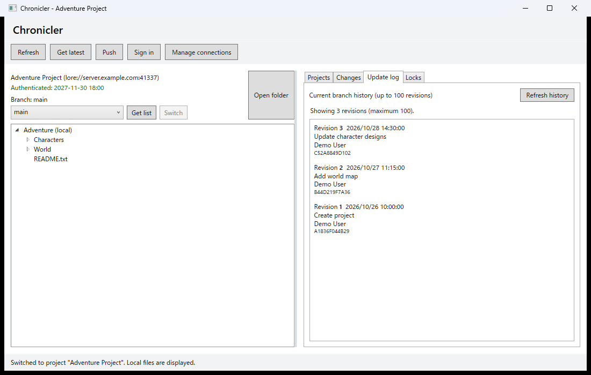

# Chronicler

Chronicler is a Windows desktop client for Lore.



The screenshot uses sample project and history data.

It is currently in the early stages of development. It supports browser login, retrieving repository lists, cloning, switching projects, viewing local files, staging and unstaging, local commits and pushes, acquiring file locks, listing your locks, and releasing locks. It records the server endpoint for each project and shows projects from different servers in one list. You can also register endpoint shortcuts for new projects. It does not connect to a server or open a browser at startup.

## Development environment

- Windows x64
- .NET 10 SDK
- Lore C# SDK `LoreVcs` 0.12.0 (restored from NuGet)

The project runtime identifier is set to `win-x64` so that the Lore SDK native library can be restored. The first build requires access to NuGet. A local `lore-dotnet` repository is not required to build.

## Releases

When you push an annotated `vX.Y.Z` tag to `main`, GitHub Actions runs tests in the Release configuration and builds a self-contained, single-file Windows x64 version. The generated `Chronicler-win-x64.zip` is attached to the GitHub Release for that tag.

```powershell
git tag -a v0.0.1 -m "Release v0.0.1"
git push origin v0.0.1
```

## Documentation

- [Documentation overview](docs/README.md)
- [Build and run](docs/development/build-and-run.md)
- [Login](docs/guide/login.md)
- [Registering server connections](docs/guide/server-connections.md)
- [Creating projects](docs/guide/projects.md)
- [Viewing the update log](docs/guide/update-log.md)
- [Testing](docs/development/testing.md)
- [Development notes](docs/development/development-notes.md)
