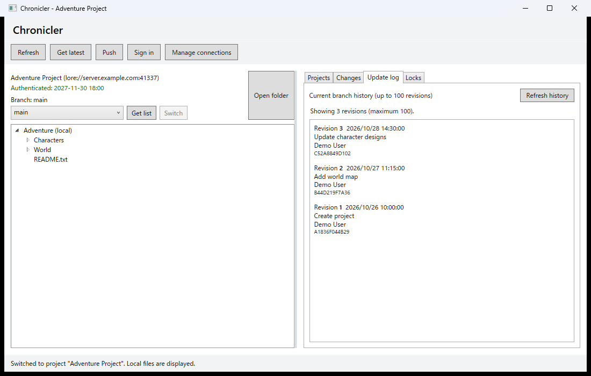

# Chronicler documentation

Chronicler is a Windows desktop client for Lore. The workspace lets you open projects, browse local files, and review revision history.

The screenshot uses sample project and history data.

## Getting started

- [Register a server connection](guide/server-connections.md)
- [Create or register a project](guide/projects.md)
- [View the update log](guide/update-log.md)
- [Sign in](guide/login.md)

## Development

- [Build and run](development/build-and-run.md)
- [Testing](development/testing.md)
- [Development notes](development/development-notes.md)
