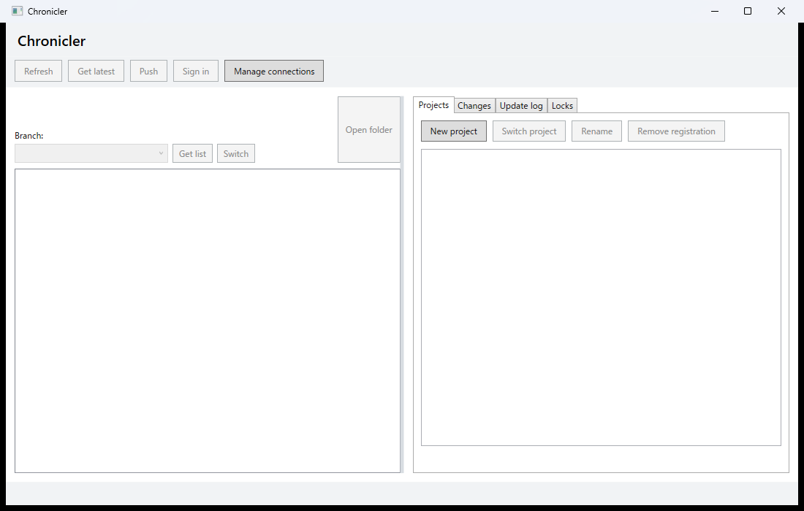
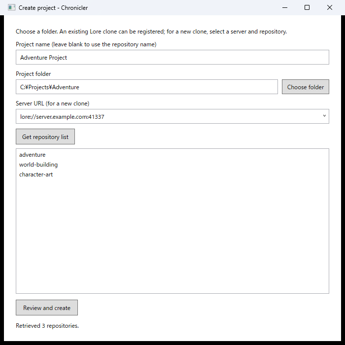

# Creating projects

In the workspace, use **New project** on the **Projects** tab to open the project creation screen.

The repository names in the screenshot are sample data.

### Clone a repository

1. On the workspace's **Projects** tab, select **New project**.
2. Enter a project name, or leave it blank to use the repository name suggested when you select a repository. A name you entered is not overwritten.
3. Choose a project folder or enter its full path. Use an empty existing folder or a new path whose parent folder exists.
4. Enter a server URL such as `lore://server.example.com:41337`, or select a [saved connection](server-connections.md). Do not include a repository path or credentials. Select **Get repository list**, continue with login or existing credentials, and select a repository.
5. Check the project name and select **Review and create**. Confirm the details. This registers the project but does not clone it yet.
6. With the new project open, select **Get latest** and confirm to start the initial clone.

### Register an existing clone

Select **New project**, then choose the existing Lore workspace folder or enter its full path. The server URL is read from its Lore configuration when you choose the folder or leave the input field. Enter a project name, or leave it blank to use the repository name. Select **Review and create**, continue with login or existing credentials, and confirm the details. Chronicler verifies that the same repository ID exists on the server; registration does not update files.

You can change a project name later with “Rename.”

Use “Manage connections” next to “Sign in” at the top of the workspace to save, edit, or delete server display names and URLs as shortcuts. Display names can contain up to 32 characters when created or changed. Endpoints registered in earlier versions remain usable, and older display names longer than 32 characters can still be read. Registering a shortcut does not connect to the server or store credentials. Changing or deleting a shortcut does not affect the endpoint or Lore credentials for existing projects. If settings cannot be read, an error is displayed and the file is not changed; for a new project, you can enter the URL directly.

The right side of the workspace contains the “Projects,” “Changes,” and “Update Log” tabs. Select a saved project on the “Projects” tab and open it with “Switch Project” or by double-clicking. The left side shows a top-level folder named after the workspace folder on that PC with “(local)” appended, along with its files and folders. Change status appears on the “Changes” tab. Lore scans the local workspace when a project is opened and when “Refresh” is selected. The scan updates Lore's local management data but does not connect to the server. External edits appear after the next refresh. Ignored items follow the Lore configuration, and an error is displayed if status cannot be determined. For projects from older versions with no registered ID, the server is queried during the first verification. The display is not the file status on the server. Lore's internal `.lore` folder is not shown, and link targets are not expanded.

The “Changes” tab displays only changed items and their parent folders in the actual folder hierarchy. Folders can be expanded and collapsed, and the selection menu switches between “All Changes,” “Unstaged,” and “Staged.” Icons indicate deletions, additions, edits, and other changes. Staged items appear in green with `✓`; unstaged items appear in yellow with `・`. Deleted files can also be selected from the tree. Select unstaged files or folders and choose “Stage” to stage the selected changes. Multiple selection is supported. Only displayed items are used for selection; changing the filter or expanding or collapsing a folder clears the selection. Selecting a folder recursively scans its contents and stages additions, edits, and deletions. A folder marker indicates its own or its descendants' status; `✓・` appears if both statuses exist. Displaying a parent folder does not mean that it is itself a commit target. Before operating on a folder, the application shows the scope of the operation, including items hidden by the filter. Links cannot be selected and staged directly.

Select staged items and choose “Unstage” to remove them from the staging area. Multiple selection is supported. When you unstage a folder, all staged changes in its descendants are included regardless of their type or the display filter. Unstaging does not discard edits to workspace files. After an operation, the application retrieves changes and staging state again, and shows the state if the operation fails or unresolved conflicts exist. Unresolved conflicts are omitted from the list and their count is displayed. Staging and unstaging are local operations; they do not send changes to the server or create commits.

Enter a message below the list and choose “Commit” to create a local commit on the current branch. All staged changes are included, regardless of the display filter or list selection. The commit area always shows the target count and confirms the count and paths before execution. You can inspect targets that do not fit in the confirmation dialog in “Staged.” **If you edit a file again after staging it, its contents at commit time are used even if you do not stage it again.** The staging state is checked again immediately before committing; the operation is canceled if it changed from the list or unresolved conflicts exist. An empty message cannot be committed. After committing, the application retrieves the list and update log again. On success, the message field is cleared; it is retained on failure or cancellation. Message drafts are retained per project only while the application is running.

Commits are not sent to the server. Depending on the environment, credentials usable locally may be required. If the result cannot be confirmed, check the update log and staging state before retrying to avoid duplicate commits.

“Push” at the top sends committed history on the current local branch to the server. It does not send uncommitted changes. It checks the endpoint and history in advance, and cancels if the server is ahead or the histories have diverged. If the prerequisite check determines that authentication is required, browser login starts and the check is retried once after it completes. It does not force-push or merge automatically. If the branch does not exist on the server, Lore creates or restores it through its normal behavior. Lore link targets and layer repositories may also be sent. A confirmation dialog shows the targets, and the server revision is checked after completion. If it fails or cannot be confirmed, some changes may already have been sent, so check the server state before retrying. Avoid running it concurrently with external changes.

Right-click a file in the explorer on the left and select “Lock” to lock that file on the current branch. Acquisition and release use the project's workspace folder as their base and do not depend on the directory from which Chronicler was started. Folders, links, and Lore management areas are excluded. An error is shown for targets Lore cannot lock, such as untracked files, or when another user's lock conflicts.

Choose “Show My Locks” on the “Changes” tab to list files locked by the currently logged-in user in the open project across all branches. Choose “Back to Changes” to return to the changes view without losing the commit message or filter. Review the file path and branch ID, select an item, then choose “Release selected lock” to release only that branch's lock after confirmation. It does not release other users' locks or locks in other projects. Locks are retrieved the first time the view is opened; use “Get list” to refresh changes made externally.

Acquiring, releasing, and listing locks require a server connection and authentication. Errors are displayed on failure, and acquisition or release is not retried automatically. If needed, use “Login” at the top before trying again. After acquisition or release, the lock list and lock icons on the left are retrieved again, including after a failure. If the result of an acquisition cannot be confirmed, refresh the list before trying again. Verify behavior on an actual server in a trial repository approved by your administrator.

Errors and warnings while retrieving lock icons are shown in the workspace status area at the bottom.

“Update Log” displays up to 100 revisions, newest first, from the current local branch of the open project. It shows the revision number, message, author, date and time, and revision ID. If data required to display history is not available locally, it is retrieved from the server. For a project waiting for its initial retrieval, history is available after cloning. Use “Refresh history” to reload history updated externally.

Above the file tree, the open project's name and server URL appear alongside its authentication status and branch controls. Branches are retrieved when switching projects, after the initial clone completes, and when the user chooses “Get list”; the current branch is shown above the selection menu. The menu displays branch names only. Select a branch and choose “Switch” to update workspace files after confirmation. The **Branches** tab also lists branches and provides controls to create, switch, and delete them. To create a branch, enter a name and choose **Create branch**; right-click empty space in the list for the same command. Select a non-current branch, then choose **Switch branch** or right-click it and choose **Switch branch**. Deleting a branch archives it, so it is hidden from the normal list; the current branch cannot be deleted. If the server list cannot be retrieved, that fact is displayed and only the local branches that could be retrieved are shown. A branch that exists locally is switched to its local revision, so use “Get latest” after switching to obtain the server's latest state. Switching to a branch that exists only on the server requires connectivity and authentication.

Switching does not use forced overwrite or reset; Lore determines whether uncommitted changes can be retained. Switching can fail if staged changes or conflicting changes exist. Even after a failure, some files may have changed, so check the state shown in the application and the local files.

“Get latest” clones a project waiting for its initial retrieval. For an existing clone, it checks the server's latest revision for the current branch and updates workspace files through Lore sync. Files may be added, changed, or deleted. The operation is canceled if local and server histories have diverged, local history is ahead, or the server cannot be checked. It does not automatically merge or forcibly reset local changes. It cannot be canceled while in progress. After an attempted update, the branch list is reloaded; if it cannot be reloaded, an error is shown instead of a potentially stale selection. Even after a failure, some files may have changed, so check the local state. The retrieval target is the server revision at the time of confirmation.

“Submit” is not implemented and cannot be used. The tree on the server, checkout, and related features are also not implemented.

A project is a Chronicler-specific setting that associates a Lore repository with a workspace folder on a PC. You can clone the same repository into different folders and register it more than once. Project information is stored per PC in `%LOCALAPPDATA%\Chronicler\projects.json`.

The initial clone does not start in a non-empty folder. If cloning fails or is interrupted after it begins, the partial folder is not deleted or retried automatically. Review its contents, then delete the registration and create the project again if necessary. If you can confirm that the clone completed successfully, you can register it again as an existing clone. Deleting a project registration does not delete the local folder or data on the server.

When switching projects, Chronicler compares the Lore endpoint and repository ID with the registered information and cancels if they do not match. It also checks local and server information before Get latest. For projects registered by earlier versions, it verifies the repository information on the server and registers the ID during the first switch. This requires connectivity and login. Chronicler does not rewrite Lore settings or IDs to repair mismatches. Clone the repository again to switch to a different repository.

Compatibility and permissions for retrieving repository lists, cloning, and Get latest have not been verified in a production environment. First verify them in an administrator-approved trial repository and an empty folder. Clone cancellation is not yet implemented.
