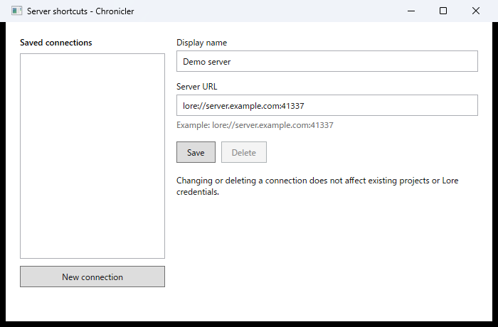

# Registering server connections

Save a server connection as a shortcut so you can select its URL when creating a project.

1. In the workspace, select **Manage connections**.
2. Select **New connection**.
3. Enter a **Display name** and **Server URL**, for example `lore://server.example.com:41337`. Use the server endpoint only: do not include a repository path, credentials, query, or fragment.
4. Select **Save**. The connection appears in the saved connections list.
5. Close the window. When creating a project, you can select the saved connection in the server URL field.

Display names must be unique, ignoring case, and can contain up to 32 characters when created or changed. To edit a shortcut, select it in the list, change its fields, and choose **Save**. To remove it, select it and choose **Delete**, then confirm.

Saving a shortcut does not connect to the server or store credentials. Editing or deleting it does not change existing projects or Lore credentials. You can also enter a server URL directly when [creating a project](projects.md). For authentication, see [Sign in](login.md).
