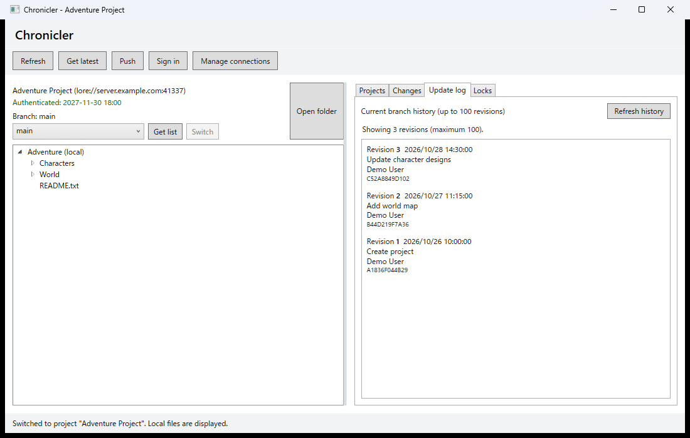

# Viewing the update log

The update log shows revisions on the current local branch of the open project.

1. If necessary, create a project and complete its initial download as described in [Creating projects](projects.md).
2. On the **Projects** tab, select the project and choose **Switch project**, or double-click it.
3. Select the **Update log** tab. The history loads when you open the tab.
4. Review the revision number, timestamp, message, author, and revision ID. Up to 100 revisions are shown, newest first.
5. Select **Refresh history** to reload history after changes made outside Chronicler.

The log is for the current local branch, not necessarily the latest server state. Use **Get latest** to update the project when appropriate; if history data is not available locally, Lore may retrieve it from the server. A project awaiting its initial download has no available history until cloning completes.

The screenshot uses sample project and history data.
